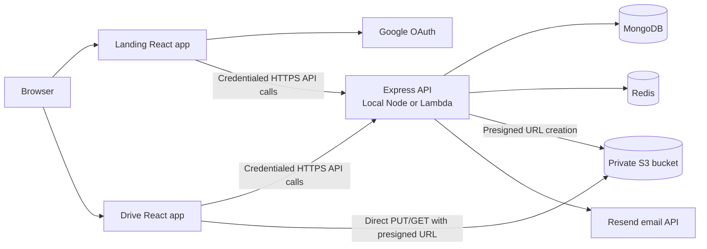
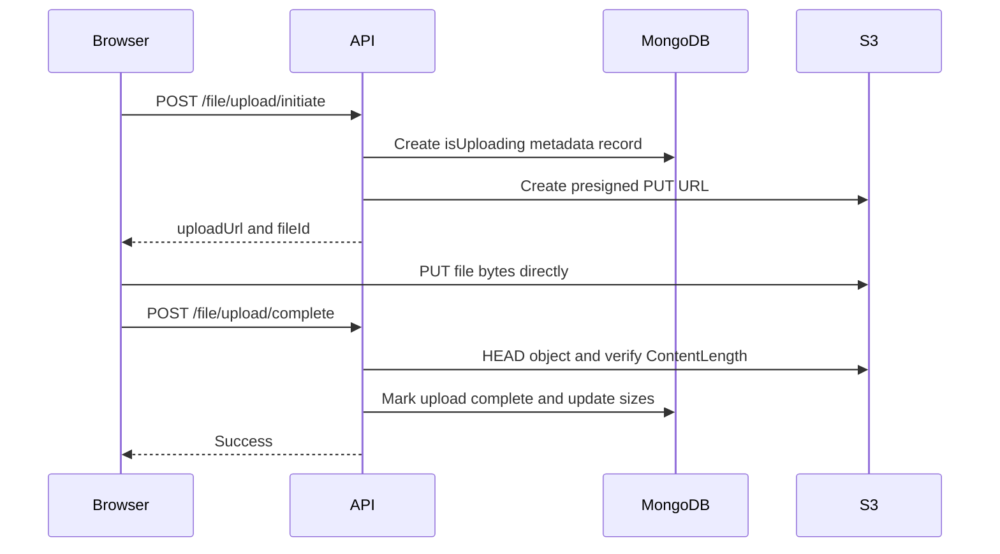

# SwiftStash Architecture and Implementation Reference

**Document purpose:** Technical reference for the current SwiftStash codebase.

**Repository status:** The repository contains deployment preparation and local verification tooling, but the cloud deployment itself is not confirmed as complete. This report describes the implementation currently present in source control and distinguishes it from planned infrastructure.

## 1. Product Summary

SwiftStash is a cloud file-storage application composed of:

- A public landing and authentication application.
- An authenticated React drive application.
- A TypeScript Express API that owns authentication, authorization, metadata, and storage URL issuance.
- MongoDB for users, directories, and file metadata.
- Redis for sessions, OTPs, and session search/indexing.
- Amazon S3 for private file bytes, accessed from browsers through presigned URLs.

The system deliberately keeps large file transfers out of the API path. The browser uploads and downloads directly from S3 after the API authorizes the operation and issues a short-lived URL.

## 2. System Context



### Runtime modes

1. **Local server:** `Backend/src/server.ts` initializes MongoDB, Redis, and the Redis Search index, then starts an Express listener.
2. **Lambda:** `Backend/src/lambda.ts` adapts the Express app through `serverless-http`, initializes services per handler invocation, and normalizes cookies for HTTP API payload version 2.0.
3. **Static web applications:** `Frontend` and `Landing` are independent Vite builds intended for separate static hosting sites.

## 3. Repository Structure

```text
Backend/
  src/
    app.ts                         Express middleware and route composition
    server.ts                      Local HTTP server and graceful shutdown
    lambda.ts                      AWS Lambda adapter and cookie normalization
    config/                        Environment and external-service initialization
    middlewares/                   Auth, validation, upload, and rate limiting
    modules/
      auth/                        Password, OAuth, OTP, session, and auth routes
      user/                        User model, account operations, and routes
      directory/                   Directory model, hierarchy, and routes
      file/                        File metadata, S3 transfer, and routes
    types/                         Shared API and repository types
  scripts/                         Lambda packaging and Amazon Linux verification
  test/                            Node test-runner tests
  deployment/                      Generated or reserved deployment artifacts

Frontend/
  src/                             Authenticated drive experience
  public/                          Static assets
  netlify.toml                     Static deployment configuration

Landing/
  src/                             Marketing, registration, login, and OAuth UI
  public/                          Static assets
  netlify.toml                     Static deployment configuration

README.md                          Deployment and operational notes
ARCHITECTURE_REFERENCE.md          This report
```

## 4. Backend Architecture

The backend follows a lightweight layered structure:

```text
HTTP request
  -> Express middleware
  -> route-level validation and rate limiting
  -> controller
  -> service
  -> repository / external service client
  -> response
```

### Application composition

`Backend/src/app.ts` configures:

- Helmet security headers and a CSP allowing the Google OAuth origins used by the application.
- Credentialed CORS using development origins plus `CORS_ALLOWED_ORIGINS`.
- JSON and URL-encoded request parsing.
- Signed cookie parsing using `COOKIE_SECRET`.
- Request logging.
- `/health` and root informational endpoints.
- Rate-limited route groups.
- A final 404 handler and generic 500 error handler.

Route groups are mounted under `/api/v1`:

| Group | Rate limit | Authentication |
| --- | --- | --- |
| `/auth` | 10 capacity, refill 0.5 | Mixed public and protected routes |
| `/directory` | 30 capacity, refill 2 | Required |
| `/file` | 100 capacity, refill 15 | Required |
| `/user` | 10 capacity, refill 0.5 | Required |

The rate limiter is Redis-backed, so availability of Redis is part of request-path availability.

### Service initialization

`initializeServices.ts` coordinates startup:

1. Connect to MongoDB, with recovery handling for a previously connected Mongoose connection.
2. Connect to Redis and wait for readiness.
3. Validate or create the Redis Search index `sessionIdx`.
4. Confirm both services are ready.

Initialization attempts are cached while in progress so concurrent Lambda invocations or startup paths do not duplicate the same initialization work.

## 5. Authentication and Session Design

### Password authentication

1. Registration validates input with Zod.
2. `AuthService.registerUser` creates a user and root directory in one Mongo transaction.
3. Passwords are hashed by the Mongoose user model using Argon2 and `ARGON_SECRET`.
4. Login validates the password and creates a Redis session.
5. The session ID is returned only through a signed, HTTP-only `sid` cookie.

### Google OAuth

`OAuthService.fetchUserFromGoogle` exchanges the authorization code with Google and verifies the returned ID token against `GOOGLE_CLIENT_ID`.

For a new Google user, `handleLogin`:

1. Creates a user ID and root directory ID.
2. Inserts the user and root directory in a Mongo transaction.
3. Commits and ends the Mongo session.
4. Enforces the device limit in Redis.
5. Creates the Redis session and returns its ID.

The Redis operations intentionally occur after the Mongo transaction. This prevents a Redis failure from causing an invalid `abortTransaction()` call after Mongo has already committed.

### OTP flow

OTP codes are generated with `crypto.randomInt`, hashed with Argon2, stored in Redis with a five-minute TTL, and sent through Resend. Verification reads the stored hash and checks it with Argon2.

### Request authorization

`authMiddleware` reads the signed `sid` cookie, loads the corresponding Redis JSON document, and verifies that the referenced user still exists in MongoDB. It then places the user ID on `req.userId` for controllers and services.

### Session limits

Sessions are stored under `swiftstash:session:<sessionId>`. The `sessionIdx` Redis JSON index exposes:

- `userId` as a TAG field for filtering.
- `createdAt` as a sortable TEXT field.

The application removes the oldest sessions when enforcing the two-device limit.

## 6. Data Model

### User

MongoDB collection: `users` through the Mongoose `User` model.

Important fields:

- Identity: `name`, unique lower-cased `email`, `picture`.
- Authentication: optional password, `hasPassword`.
- Storage: `rootDirectory`, `currentStorageSize`, `maxStorageSize`.
- State: `role`, `isDisabled`, `isDeleted`.
- Audit: `createdAt`, `updatedAt`.

New users receive a one-gigabyte default storage limit and a generated root directory.

### Directory

MongoDB collection: `directories` through the `Directory` model.

Directories store their parent ID and an `ancestors` array. The ancestor array supports breadcrumb generation, recursive traversal, and aggregate size updates without reconstructing the whole tree for every request. Directory records also track aggregate `size`, owner, and sharing state.

### File metadata

MongoDB collection: `files` through the `File` model.

File records contain:

- Display metadata: `name`, `extension`, `type`, `size`.
- Ownership and hierarchy: `userId`, `parentDirectoryId`.
- State: `isUploading`, `isShared`.
- Audit timestamps.

The actual object is stored in S3 under a key composed from the file ID and extension. The database record is the source of truth for ownership and metadata.

## 7. File Transfer Implementation

### Recommended upload flow



`StorageService` creates one-hour presigned upload and inline-download URLs. Download URLs use a shorter five-minute lifetime when the request is explicitly a file download.

The completion step verifies that the S3 object exists and has the expected size before updating `isUploading` and storage counters. Failed verification deletes the S3 object.

The API also supports recursive ZIP generation for multiple files and directories. That path streams S3 objects into an `archiver` response, but because it is handled synchronously by the API or Lambda, archive size is constrained by the selected runtime and response limits.

There is an older multipart upload path in `FileController` that is currently disabled in the route file. The active path is direct-to-S3 upload.

## 8. API Reference

All API paths are prefixed with `/api/v1`.

### Authentication

| Method | Path | Purpose | Auth |
| --- | --- | --- | --- |
| GET | `/auth/me` | Return the current user metadata | Required |
| POST | `/auth/check-user-exists` | Check whether an email exists | Public |
| POST | `/auth/register` | Register a password account | Public |
| POST | `/auth/login` | Create a password session | Public |
| POST | `/auth/google-login` | Exchange a Google code and create a session | Public |
| POST | `/auth/logout` | Delete the current session | Required |
| POST | `/auth/logout-all-devices` | Delete all sessions for the user | Required |
| POST | `/auth/send-otp` | Generate and send an OTP | Public |
| POST | `/auth/verify-otp` | Verify an OTP | Public |

### Directories

| Method | Path | Purpose |
| --- | --- | --- |
| GET | `/directory/:dirId?` | List directory contents and breadcrumb path |
| POST | `/directory/:dirId?` | Create a child directory |
| PATCH | `/directory/:dirId` | Rename a directory |
| DELETE | `/directory/:dirId` | Delete a directory tree and its files |
| DELETE | `/directory/bulk-delete` | Delete multiple directory trees |

### Files

| Method | Path | Purpose |
| --- | --- | --- |
| GET | `/file/:fileId` | Redirect to a presigned view or download URL |
| POST | `/file/upload/initiate` | Create metadata and a presigned upload URL |
| POST | `/file/upload/complete` | Validate the S3 object and finalize metadata |
| POST | `/file/upload/cancel` | Remove an unfinished upload |
| POST | `/file/bulk-download` | Stream selected items as a ZIP |
| PATCH | `/file/:fileId` | Rename a file without changing its extension |
| DELETE | `/file/:fileId` | Delete one file and its S3 object |
| DELETE | `/file/bulk-delete` | Delete multiple files and their S3 objects |

### Account management

| Method | Path | Purpose |
| --- | --- | --- |
| POST | `/user/set-password` | Set a password for an account without one |
| POST | `/user/update-password` | Change an existing password and invalidate sessions |
| DELETE | `/user/delete-account` | Validate password and remove the account tree |

Zod middleware validates request bodies and parameters before controllers execute. Successful responses use `{ success, message, data? }`; failures use `{ success, error }`.

## 9. Frontend Applications

### Landing application

The `Landing` application owns:

- Public landing pages.
- Login and registration forms.
- Google OAuth initiation and callback handling.
- Navigation to the authenticated drive application.

`googleAuth.js` validates that `VITE_BACKEND_URL` includes the `/api/v1` prefix, posts the Google authorization code to `/auth/google-login`, and sends credentials with the request.

### Drive application

The `Frontend` application owns the authenticated file-management experience:

- Drive browsing and breadcrumbs.
- Directory creation, rename, and deletion.
- File upload, completion, cancellation, rename, download, and deletion.
- Account settings and password management.
- Shared/manage-people UI surfaces.

`AuthProvider` restores the current user through `/auth/me`. When the session is missing or invalid, it redirects to the configured landing origin. `axiosInstance.js` uses `VITE_BACKEND_URL`, a 15-second timeout, JSON headers, and `withCredentials: true`.

The drive uses React Router with lazy-loaded pages and an `AppLayout` containing the sidebar, top bar, and page outlet. Several sidebar destinations are currently represented as “Coming Soon” placeholders rather than implemented backend capabilities.

## 10. Configuration and Secrets

Backend environment variables are validated at startup with Zod. Required groups include:

- MongoDB and Redis connection URLs.
- Cookie and Argon2 secrets, each at least 32 characters.
- Google OAuth and Resend credentials.
- AWS region and S3 bucket name.
- Optional port, environment, and CORS origin list.

Frontend and Landing use Vite `VITE_` variables for public configuration such as the API URL and application origins. These values are embedded into browser assets and must not contain secrets.

Local `.env` files must remain outside source control. Any credential-like values that have been exposed or committed should be rotated before production use.

## 11. Deployment Design

The prepared deployment target is:

- Netlify site for `Frontend`.
- Netlify site for `Landing`.
- AWS Lambda Node.js 24.x, x86_64, handler `dist/lambda.handler`.
- Lambda Function URL using HTTP API payload format 2.0.
- Private S3 bucket with least-privilege object permissions.

`Backend/scripts/package-lambda-al2023.sh` builds and packages the backend inside the official Amazon Linux 2023 Node.js 24 image using rootless Podman. It excludes environment files, tests, frontend sources, landing sources, and development dependencies from the final package. `verify-al2023-lambda.sh` performs the corresponding compatibility checks.

The Lambda execution role needs object-level S3 permissions for the operations used by the source, plus CloudWatch Logs permissions. MongoDB Atlas, Redis Cloud, Google OAuth, and Resend remain external services and require their own credentials and network allowlists.

## 12. Verification and Test Coverage

Current tests include:

- `Backend/test/oauth-transaction.test.mjs`: verifies commit/abort behavior, post-commit Redis failures, session cleanup, and preservation of original errors.
- `Backend/test/lambda-cookies.test.mjs`: verifies HTTP API v2 cookie normalization, login cookies, logout clearing cookies, and multiple cookie values.
- `Backend/test/redis-index-initialization.test.mjs`: verifies Redis Search index initialization and schema handling.
- `Landing/test/authNavigation.test.js`: verifies Google authentication URL and request behavior.

The backend package defines `typecheck`, Lambda build, development server, and focused test scripts. The Amazon Linux verification script additionally checks TypeScript compilation, Lambda import behavior, Argon2 native compatibility, and production-only dependency installation.

## 13. Implementation Risks and Follow-up Areas

These are reference concerns visible in the current implementation, not claims that deployment is broken:

1. **Credential exposure:** Local environment files must not be committed or copied into deployment artifacts. Rotate any credentials that have been exposed.
2. **Cross-site cookies:** The session cookie uses `SameSite=Lax` while Landing, Frontend, and the API are designed as separate origins. The final deployed origin arrangement must be tested in supported browsers; a same-site proxy or domain strategy may be required.
3. **Transaction consistency:** User and directory creation is transactional in the registration and new-Google-user paths, but many file and directory mutations coordinate MongoDB and S3 through separate operations. Retry and compensation behavior should be reviewed for partial failures.
4. **Account deletion:** `UserService.deleteAccount` performs external S3 deletion work while a Mongo transaction is open. A storage failure can leave the transaction pending or cause a mismatch between database and object storage state; an outbox or staged deletion process would be more resilient.
5. **Bulk ZIP limits:** Synchronous ZIP generation is unsuitable for arbitrarily large downloads in Lambda because of memory, duration, and response-size limits.
6. **Session and OTP observability:** Authentication middleware, OTP verification, and several services log operational details. Production logging should be reviewed to ensure secrets, tokens, and personal data are never emitted.
7. **Error classification:** The generic Express error handler returns HTTP 500 for all uncaught errors. A production API would benefit from typed operational errors and deliberate 4xx/5xx mapping.
8. **Feature completeness:** Shared files, starred, recent, people, and trash navigation surfaces exist in the drive UI, but several are currently placeholders. The backend data model has `isShared`, but the complete sharing workflow is not represented by the current route inventory.
9. **Concurrency controls:** Upload completion, storage-size updates, and recursive deletion should be tested under retries and concurrent requests to ensure counters remain correct.

## 14. Recommended Local Verification

From the repository root:

```sh
cd Backend
npm ci
npm run typecheck
npm run test:lambda-cookies
node --test test/oauth-transaction.test.mjs test/redis-index-initialization.test.mjs
```

For frontend and landing validation:

```sh
cd Frontend && npm ci && npm run build
cd ../Landing && npm ci && npm run build
```

Before a cloud release, also run the Amazon Linux packaging verification, configure exact production CORS/CSP origins, validate cookie behavior in a real browser, and confirm S3/IAM permissions with a non-production bucket.

## 15. Key Reference Files

- [Root README](README.md): deployment assumptions, environment inventory, and operational notes.
- [Express application](Backend/src/app.ts): middleware and API composition.
- [Local server](Backend/src/server.ts): service startup and shutdown.
- [Lambda adapter](Backend/src/lambda.ts): serverless entry point and cookie handling.
- [Service initialization](Backend/src/config/initializeServices.ts): MongoDB, Redis, and index readiness.
- [Authentication routes](Backend/src/modules/auth/auth.routes.ts): public and protected auth endpoints.
- [File routes](Backend/src/modules/file/file.routes.ts): active direct-upload and file-management endpoints.
- [Storage service](Backend/src/modules/file/storage.service.ts): S3 key and presigned URL behavior.
- [Drive application](Frontend/src/App.jsx): authenticated route tree.
- [Google authentication client](Landing/src/api/googleAuth.js): browser OAuth-to-API handoff.
- [Lambda package script](Backend/scripts/package-lambda-al2023.sh): deployment artifact construction and runtime checks.