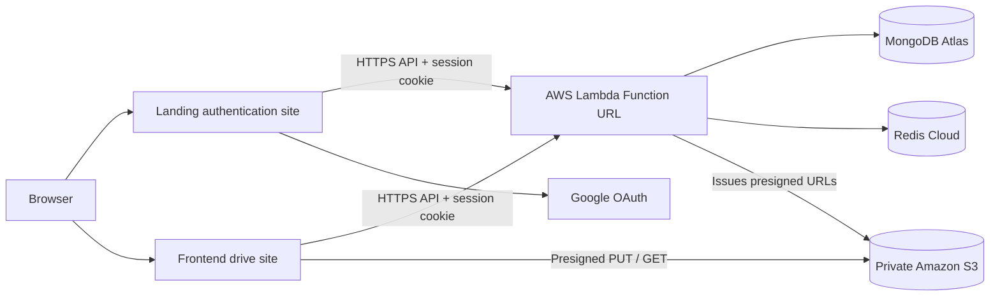

# SwiftStash

SwiftStash is a cloud file storage application with a React drive, a separate authentication experience, and an Express API. It supports user authentication, file and directory metadata, direct-to-S3 file transfer, and session-backed access.

> **Deployment status:** Deployment configuration prepared. Actual cloud deployment has not yet been performed.

## Technology stack

- **Frontend and Landing:** React, Vite, React Router
- **Backend:** Express 5, TypeScript, Node.js 24 Lambda handler
- **Authentication and sessions:** Google OAuth, signed HTTP cookies, Redis Cloud and MongoDB
- **File storage:** Private Amazon S3 with presigned PUT and GET URLs
- **Planned hosting:** Netlify for each static application; AWS Lambda Function URL for the API

## Architecture



File bytes are transferred directly between the browser and private S3 using short-lived presigned URLs. The backend handles authorization, metadata and URL issuance. MongoDB stores application records and file metadata; Redis supports sessions and search.

## Repository layout

```text
Backend/   Express API, Lambda entry point, deployment scripts and tests
Frontend/  Main authenticated drive application
Landing/   Login, registration and Google OAuth application
```

Frontend and Landing are configured as independent Netlify sites. Each site uses its own `netlify.toml`, Vite build, `dist` publish directory and SPA fallback.

## Local development

Use Node.js 24 and npm. Install and run each application from its own directory:

```sh
cd Backend
npm ci
npm run dev
```

```sh
cd Frontend
npm ci
npm run dev
```

```sh
cd Landing
npm ci
npm run dev
```

The Vite development ports are configured by the respective Vite projects. Backend local startup requires the environment variables listed below and reachable MongoDB and Redis services. Do not commit local environment files.

## Environment configuration

Set values in the appropriate local environment or hosting provider configuration. This documentation lists variable names and purpose only; it contains no credentials or connection strings.

### Backend

| Variable | Startup requirement | Purpose |
| --- | --- | --- |
| `MONGO_URI` | Required | MongoDB connection URI |
| `REDIS_URL` | Required | Redis connection URL |
| `ARGON_SECRET` | Required | Secret used for password hashing |
| `COOKIE_SECRET` | Required | Cookie signing secret |
| `GOOGLE_CLIENT_ID` | Required | Google OAuth client identifier |
| `GOOGLE_CLIENT_SECRET` | Required | Google OAuth server credential |
| `RESEND_API_KEY` | Required | Email delivery credential |
| `AWS_REGION` | Required | AWS SDK region |
| `AWS_BUCKET_NAME` | Required | Private file bucket name |
| `CORS_ALLOWED_ORIGINS` | Optional in schema; configure in production | Comma-separated complete browser origins allowed by the API |
| `PORT` | Optional; defaults to `3000` | Local Express listener port |
| `NODE_ENV` | Optional; defaults to `development` | Runtime environment mode |

The Lambda SDK client uses the AWS default credential provider chain. Do not configure long-lived access keys in Lambda; grant the function an execution role instead.

### Frontend build-time variables

Vite embeds `VITE_` variables into public browser assets. They must never contain secrets.

| Variable | Application | Purpose |
| --- | --- | --- |
| `VITE_BACKEND_URL` | Both | Backend API base URL, including the `/api/v1` prefix |
| `VITE_BULK_DOWNLOAD_URL` | Frontend | Full backend bulk-download route URL |
| `VITE_LANDING_ORIGIN` | Frontend | Landing site's browser origin for login navigation |
| `VITE_MAIN_APP_ORIGIN` | Landing | Main drive site's browser origin for post-auth navigation |
| `VITE_GOOGLE_CLIENT_ID` | Landing | Public Google OAuth client ID |

Use actual HTTPS origins and API endpoints selected for the deployment. No production domains or endpoint values are assigned in this repository.

## Deployment configuration

### Static sites

Create two separate Netlify sites, using `Frontend/` and `Landing/` as their respective base directories. Their `netlify.toml` files specify `npm run build`, publish `dist/`, SPA routing, Node.js 24, and security headers. Configure each site's public Vite variables in its build environment.

The Content Security Policies deliberately avoid guessed hosts and broad AWS wildcards. Before publishing, add the chosen API origin to each application's `connect-src`. Add the exact regional S3 origin returned by presigned upload URLs to the Frontend `connect-src`. Google OAuth's account origin is allowed only by Landing. The existing Google profile image hosts and Google Fonts are allowed where used. Keep `script-src` free of `unsafe-inline` and `unsafe-eval`.

### AWS Lambda API

- Runtime: **Node.js 24.x**
- Architecture: **x86_64**
- Handler: **`dist/lambda.handler`**
- API transport: Lambda Function URL, using HTTP API payload format 2.0
- Package: backend-only ZIP produced by `Backend/scripts/package-lambda-al2023.sh`; its build and native dependency checks target the official Lambda Node.js 24 Amazon Linux image.

The Function URL must be configured to permit the intended browser caller. For a public browser-facing URL this commonly means unauthenticated Function URL invocation, with user authorization enforced by the application session; assess exposure before enabling it. Set the backend `CORS_ALLOWED_ORIGINS` to the exact deployed Frontend and Landing origins. Express currently owns credentialed CORS responses, so avoid configuring a second competing CORS policy on the Function URL. Verify cookie behavior in the chosen hosting/domain arrangement before release: the session cookie currently uses `SameSite=Lax`, and independent Netlify origins calling a Lambda Function URL may be treated as cross-site by browsers.

### IAM permissions

Attach a least-privilege execution role to the Lambda function:

- S3 object actions required by current code: `s3:PutObject`, `s3:GetObject`, and `s3:DeleteObject` on the application's bucket object ARN (`arn:aws:s3:::<bucket-name>/*`).
- CloudWatch Logs permissions equivalent to `logs:CreateLogGroup`, `logs:CreateLogStream`, and `logs:PutLogEvents`.
- No static AWS access-key environment variables are required. The current implementation does not require `s3:ListBucket` for its observed object operations.

The Lambda requires outbound access to MongoDB Atlas, Redis Cloud, Google OAuth and the email provider. A VPC is not required solely to reach public endpoints; if a VPC is introduced, provide appropriate outbound networking. Atlas or Redis IP allowlists may require a stable egress design; Lambda without a VPC does not provide a fixed outbound IP.

### Operations and observability

Use structured operational monitoring and alarms for Lambda errors, throttles, duration and concurrency. Configure a deliberate CloudWatch log retention period appropriate to the submission/deployment environment, and avoid logging secrets or session contents. Configure Function URL CORS and Express CORS in one authoritative layer. Confirm Lambda timeout and memory settings against real database and file metadata workloads; bulk ZIP responses are buffered and subject to synchronous Lambda response-size limits.

## Security considerations

- Keep the S3 bucket private and block public access. Presigned URLs are temporary bearer capabilities; do not log them or expose them beyond the authorized user.
- Store production secrets in Lambda environment configuration backed by an appropriate secret-management process; never put backend secrets in Vite variables or source control.
- Use the Lambda execution role for AWS credentials and grant only the object actions needed for the configured bucket.
- Use HTTPS origins, exact CORS allowlists and a reviewed production CSP. Never use credentialed wildcard CORS.
- Configure Google OAuth authorized origins and redirect behavior to match the selected deployed sites.
- Protect logs and set retention so diagnostic output does not become unnecessary long-term personal data storage.

## Known deployment limitations

- **Not deployed:** No AWS or Netlify resources have been created as part of this preparation. Hosting domains, Function URL and cloud resource identifiers remain to be selected and configured.
- **Origins must be finalized:** Production CSP and CORS need the actual site, API and regional S3 origins. The Netlify CSP is intentionally restrictive until those exact hosts are inserted.
- **Cookie site context:** The current `SameSite=Lax` cookie may not accompany cross-site browser API fetches from separate Netlify origins to a Lambda Function URL. Test the final origin arrangement in supported browsers; same-origin proxying or a domain/site strategy may be required.
- **Bulk downloads:** The backend returns ZIP data synchronously through Lambda. Lambda synchronous response limits and buffering constrain archive size; use direct presigned object downloads for individual files and verify expected bulk archive sizes before release.
- **Native dependency packaging:** `argon2` includes a native module. Build and verify the deployment package for Amazon Linux 2023, Node.js 24 and x86_64 rather than reusing host-native binaries.
- **External services:** Production MongoDB Atlas, Redis Cloud, Google OAuth and email-provider network allowlists and credentials must be configured separately.
- **CloudFront:** It is not part of the active file-delivery design; the application uses S3 presigned URLs.

## Submission status

**Deployment configuration prepared. Actual cloud deployment has not yet been performed.**
